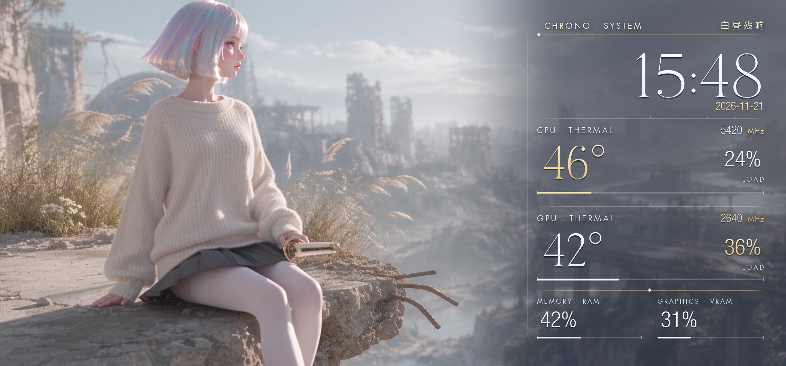
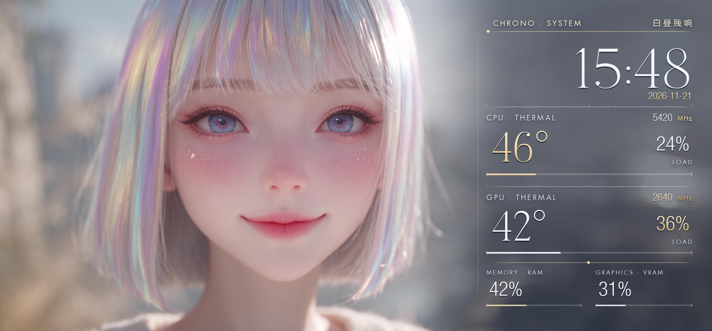
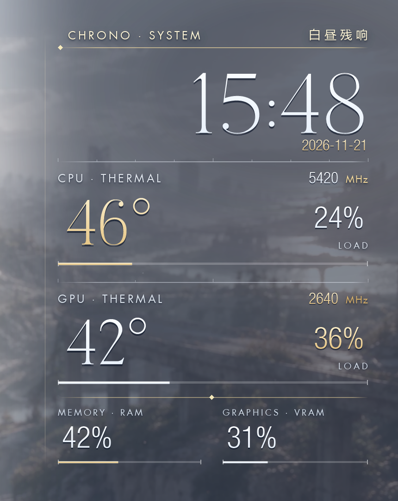
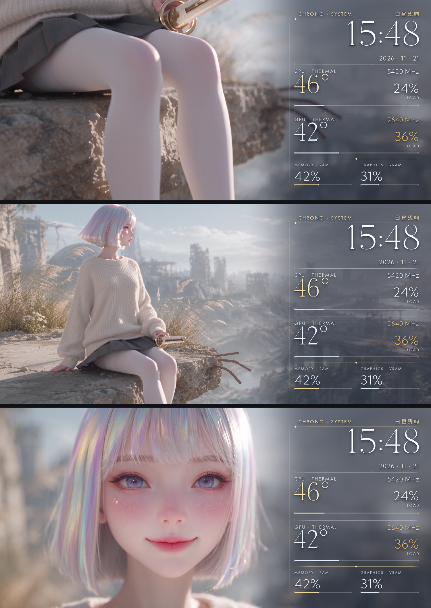

# 白昼残响 · WastelandDaydream_A — 先马 ZW360 Ultra (6.8" 曲面 OLED) 高奢无框动态主题

> 为纯白海景房装机打造的 **先马 ZW360 Ultra 6.8 寸 90° 曲面 OLED (`2320 × 1080`)** 原生动态硬件监控主题，采用 **Blender 5.2 三镜头直切白模预演 → 4K 角色/武器/浅色废土母版 → Seedance 2.5 原生 1080p 全模态生成 → 铂金×香槟金高奢制表无框 UI → `SAMA.exe` 原生 `.turtheme` 引擎编译** 全链路制作。

---

## 实机原生渲染效果预览 (`SAMA.exe` 引擎直出)

### 中景全身 · 浅色废土逆光与右侧无框遥测面板


### 尾声直切 · 超近侧脸转头甜蜜微笑（三镜头零人物遮挡）


### 右侧监控区 100% 像素级排版细节
<p align="center">
  
</p>

### 三镜头防遮挡验证（下肢特写 → 中景全身 → 转头微笑）


---

## 核心特性

- **精确适配 6.8" 90° 曲面屏 (`2320 × 1080`)**：
  - 视频经过水平镜像布局，主体人物稳定位于左侧主视区（`x = 0%–65%`），右侧专用曲面侧翼（`x = 1585–2255`）排布完整硬件监控面板，**全片三段直切镜头零人物遮挡**。
  - 背景视频已按先马硬件扫描方向预旋转 **90° 顺时针 (`1080 × 2320`, `24fps`, H.264 Main `bt709`)**，与驱动原生兼容。
- **高奢制表无框 UI 体系（大字号隔玻璃易读 + OLED 友好）**：
  - 零笨重黑框卡片：右侧采用隐形冷石板灰偏振渐变柔和压暗，在过曝奶白晨光背景下依然保持极清可读性。
  - 10 项实时硬件传感器 + 4 条极细动态进度条（全部显式设置 `queueLen = 0` 实时无滞后刷新）：
    - **时钟与日期**：`TIME (HH:mm)` · `DATE (YYYY-MM-DD)`
    - **CPU 遥测**：`CPUTEMP` · `CPUCLOCK (MHz)` · `CPULOAD (%)` + 实时香槟金极细进度条
    - **GPU 遥测**：`GPUTEMP` · `GPUCLOCK (MHz)` · `GPULOAD (%)` + 实时铂金白极细进度条
    - **内存 / 显存**：`RAMLOAD (%)` + `GPURAMLOAD (%)` + 双极细动态进度条
- **完整可复现生产管线**：仓库同步保留 Blender 5.2 白模预演工程、4K 三视图/纯入鞘武器/浅色废土场景原画、32-bit 透明 UI 叠加层与全部构建脚本。

---

## 快速安装（开箱即用）

### 方式一：一键脚本安装（推荐）
```powershell
powershell -ExecutionPolicy Bypass -File .\scripts\install_to_sama.ps1 -SamaRoot "你的先马驱动根目录，例如 H:\SAMA_Multi_Chn"
```

### 方式二：手动拷贝安装
1. 复制 [release/WastelandDaydream_A.turtheme](release/WastelandDaydream_A.turtheme) 到：
   `<SAMA_Multi_Chn>\theme\10802320\WastelandDaydream_A.turtheme`
2. 复制 [release/sama_wasteland_bg.mp4](release/sama_wasteland_bg.mp4) 到：
   `<SAMA_Multi_Chn>\video\10802320\sama_wasteland_bg.mp4`
3. 重启 `SAMA.exe`，在主题列表中选择 **`WastelandDaydream_A`** 下发至水冷头即可。

### 推荐配套字体说明
静态标签层已烘焙为无损 32-bit PNG；实时动态数字由 `SAMA.exe` 调用以下系统/软件字体渲染（未安装商业字体的机器会自动回退，建议按需自备）：
- **主数字（时钟 / 温度）**：`Butler`（`Butler_Ultra_Light.otf`，先马 `fonts\` 目录通常已自带）
- **辅数字（占用率 / 频率 / 日期）**：`HelveticaNeueLT Pro 47 LtCn`（或可在 `scripts/build_sama_theme_A.ps1` 中一键替换为 `Kumbh Sans Light` 等免费字体并重新编译）

> 如遇多副屏温度读数不一致（例如 AMD 9800X3D 误绑定 SOC VRM 传感器），请参考 [docs/sensor_sync_troubleshooting.md](docs/sensor_sync_troubleshooting.md)。

---

## 仓库目录结构

```text
sama-zw360-wasteland-theme/
├── release/                                  # 开箱即用安装文件（直接放进 SAMA_Multi_Chn）
│   ├── WastelandDaydream_A.turtheme          # 2320x1080 先马原生主题包 (queueLen=0 实时同步)
│   └── sama_wasteland_bg.mp4                 # 1080x2320 90°顺时针硬件旋转循环视频 (24fps)
├── preview/                                  # SAMA.exe 原生渲染实测图与横屏演示视频
│   ├── native_sama_A_s1.png                  # 镜头 1（下肢侧拍）原生渲染实测
│   ├── native_sama_A_s2.png                  # 镜头 2（中景全身）原生渲染实测
│   ├── native_sama_A_s3b.png                 # 镜头 3（转头微笑）原生渲染实测
│   ├── native_sama_A_zoom100.png             # 右侧监控区 100% 像素放大图
│   ├── compare_A_vs_B_shot2.png              # UI 方案 A（全监控）vs 方案 B（极简）对比
│   ├── strip_A_horology_full_3shots.png      # 三镜头零遮挡验证条
│   └── sama_wasteland_hflip_2320x1080.mp4    # 横屏 2320x1080 演示母版视频
├── assets/                                   # 4K 生产资产与 Blender 5.2 白模预演
│   ├── 01_character_turnaround_portrait_4k.png
│   ├── 02b_weapon_sheathed_only_4k.png
│   ├── 04_scene_light_wasteland_4k.png
│   ├── sama_ui_A_native_overlay.png          # 无损 32-bit 透明 UI 叠加层
│   ├── frames/                               # 三镜头无 UI 基准底帧
│   └── previz/
│       ├── screen2_sama_previz_v3.blend      # Blender 5.2 LTS 三镜头直切白模工程
│       └── screen2_sama_previz_v3_final_12s.mp4
├── scripts/                                  # 全部可复现构建与安装脚本
│   ├── install_to_sama.ps1                   # 一键安装脚本
│   ├── build_sama_theme_A.ps1                # SAMA.exe 原生 .turtheme 编译与自检脚本
│   ├── design_sama_ui_concepts.py            # 2320x1080 高奢 UI 排版与叠加层生成脚本
│   ├── build_sama_previz_v3.py               # Blender 5.2 白模预演构建脚本
│   ├── render_v3_final_mp4.py                # 白模运动参考视频渲染脚本
│   └── generate_sama_scene_4k.py             # 4K 浅色废土场景底图生成脚本
└── docs/
    ├── lighting_study_BV1UHs56DEr2.md        # 日系低饱和逆光电影光影拆解笔记
    └── sensor_sync_troubleshooting.md        # 9800X3D + RTX 5080 双副屏温度对齐指南
```

---

## 自定义重新编译主题

如果你想修改字号、配色、字体或文案，可编辑 `scripts/design_sama_ui_concepts.py` 与 `scripts/build_sama_theme_A.ps1` 后运行：

```powershell
powershell -ExecutionPolicy Bypass -File .\scripts\build_sama_theme_A.ps1 -SamaRoot "H:\SAMA_Multi_Chn"
```

脚本会直接调用本机 `SAMA.exe` 的 `UsbMonitorL` 渲染引擎生成实测预览图，并自动完成反序列化回读验证。

## License

代码与构建脚本采用 [MIT License](LICENSE)。
